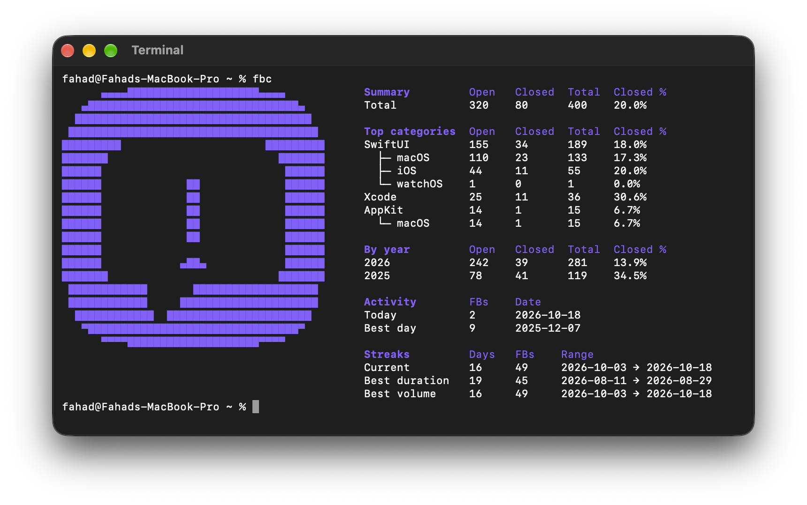

# fbc

Feedback Assistant stats from your terminal.



## Install

Run this in Terminal:

```bash
curl -fsSL https://raw.githubusercontent.com/FahadBuilds/fbc/main/install.sh | sh
```

Requires macOS and the Swift compiler, available with Xcode or the Xcode Command Line Tools.

## Commands

```bash
fbc                             # Dashboard
fbc categories                  # All category counts, highest first
fbc categories --json           # Category counts as JSON
fbc list --category "SwiftUI" --titles  # IDs and titles in a category
fbc list --category "SwiftUI" --closed --json  # Combine category and status filters
fbc list --closed               # Closed report IDs, one per line
fbc list --closed --json        # Closed report summaries as JSON
fbc show FB24490370             # Report details and cached conversation
fbc show FB24490370 --json      # Report details and cached conversation as JSON
fbc --missing                  # Reports with missing cached details
```

`categories` lists every named category with its report count, highest count first (alphabetically for ties). JSON output is an array of objects with `category` and `count`. Reports without a category are omitted from this table but remain in `list`.

`list` includes all reports unless filtered with `--closed`, `--open`, or `--category <name>`, ordered newest first. Category matching uses the full name, ignoring ASCII case; quote names containing spaces. Category and status filters can be combined. Plain output contains only IDs, suitable for piping; `--titles` adds titles in aligned columns with a two-space gap in a terminal, or separated by a tab when piped or redirected. Use either `--titles` or `--json`. JSON output remains an array of summaries with `id`, `title`, `area`, `closed`, `createdAt`, `resolution`, and `recentSimilarReports`. No matches produce an empty successful result.

Use `fbc --help` for an overview or `fbc list --help`, `fbc categories --help`, and `fbc show --help` for command help.

`show` accepts an FB number with or without the `FB` prefix. Its JSON object adds `fields`, `messages`, and `cache`. Messages include cached Apple replies, your follow-up comments, and attachment names, distinguished by `kind`. Dates use ISO 8601 in UTC; unavailable values are `null`.

All commands read local data only. Cached conversations may be incomplete, and an empty message list does not mean Apple has never replied. Opening a report in Feedback Assistant can populate missing details. Closed reports are not necessarily fixed.

Errors go to stderr with a nonzero exit status. An empty list is successful (`[]` with `--json`).

## Database access

`fbc` reads Feedback Assistant’s cached database in read-only mode. It makes no network requests or API calls.

Some report details are cached only after opening the report in Feedback Assistant.

Full Disk Access is required for your terminal app to read Feedback Assistant’s database.

## Disclaimer

`fbc` is an unofficial project and is not affiliated with Apple.

Feedback Assistant’s database schema is undocumented and may change without notice, which can break `fbc`.
