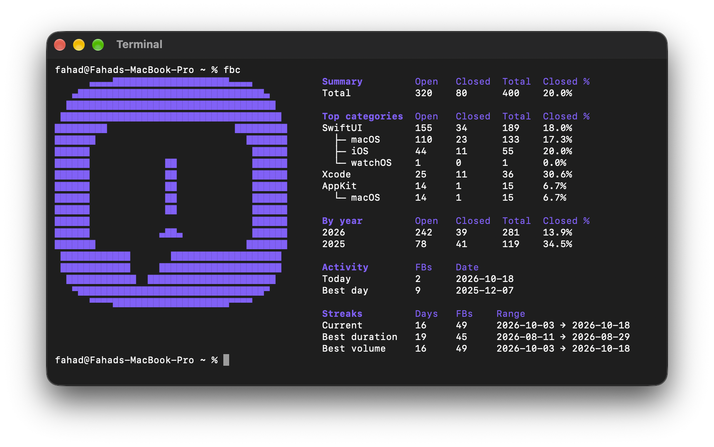

# fbc

Feedback Assistant stats from your terminal.



## Install

Run this in Terminal:

```bash
curl -fsSL https://raw.githubusercontent.com/FahadBuilds/fbc/main/install.sh | sh
```

Requires macOS and the Swift compiler, available with Xcode or the Xcode Command Line Tools.

## Database access

`fbc` reads Feedback Assistant’s cached database in read-only mode. It makes no network requests or API calls.

Some report details are cached only after opening the report in Feedback Assistant.

Full Disk Access is required for your terminal app to read Feedback Assistant’s database.

## Disclaimer

`fbc` is an unofficial project and is not affiliated with Apple.

Feedback Assistant’s database schema is undocumented and may change without notice, which can break `fbc`.
